# Applied Machine Learning Foundations: From Features to Real-World Decisions

This workshop is for an ODSC West session.

## Abstract

Machine learning is most useful when it helps practitioners move from data to better decisions. In this workshop, participants will learn a practical machine learning workflow: defining a prediction problem, preparing features, building tabular models, evaluating performance, and turning model scores into decisions.

Rather than focusing only on algorithm definitions, this session emphasizes the choices practitioners make when building real machine learning systems. We will cover core supervised learning concepts, feature engineering, model selection, validation strategy, and common failure modes such as target leakage, overfitting, misleading accuracy, and poorly chosen thresholds. Anomaly detection will be used as a recurring application to illustrate challenges such as limited labels, rare events, and false-positive versus false-negative tradeoffs.

Python demonstrations will use common open-source tools such as Pandas, NumPy, Matplotlib, and scikit-learn in Jupyter notebooks, with [marimo](https://github.com/marimo-team/marimo), a reactive Python notebook, for select demos. The workshop will cover practical model evaluation with confusion matrices, precision, recall, F1, ROC-AUC, and PR-AUC, with attention to how metric choice depends on the cost of different errors. We will also use [Flyte 2](https://github.com/flyteorg/flyte), an open-source orchestration framework, to run a scikit-learn hyperparameter search as parallel tasks that scale from a laptop to a cluster, and to turn the fraud detection workflow into a pipeline in [marimo](https://github.com/marimo-team/marimo) that reruns only the steps that changed.

By the end of the session, attendees will understand how to frame applied machine learning problems, prepare features for tabular models, compare model families, evaluate models beyond accuracy, scale model training with [Flyte 2](https://github.com/flyteorg/flyte), and communicate model results in a way that supports real-world decisions.

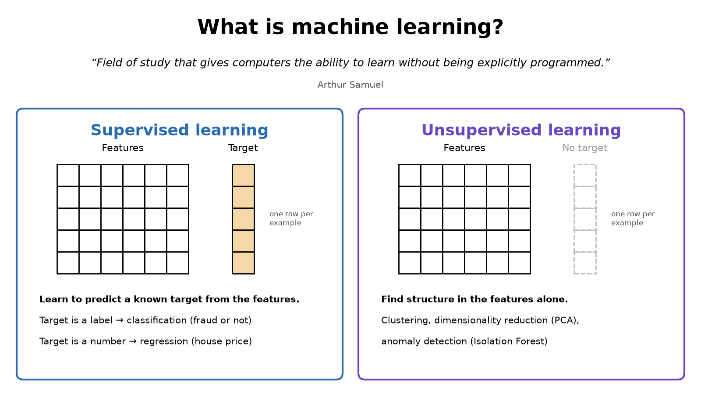

## Agenda

What we will cover:

* **Framing the problem:** turn a decision into a prediction task, format data for scikit-learn, and split it so you can trust the results.
* **Core models:** linear regression, decision trees, random forests, and logistic regression, and how each one makes predictions.
* **Evaluating beyond accuracy:** rare events, leakage, precision, recall, ROC-AUC, and PR-AUC, using credit card fraud as the running example.
* **From scores to decisions:** thresholds, costs, review capacity, and calibration.
* **Scaling up:** hyperparameter search with more cores and [Flyte 2](https://github.com/flyteorg/flyte), and a fraud pipeline in [marimo](https://github.com/marimo-team/marimo) that reruns only what changed.

<p><b>0. <a href="#installation">Setup</a>:</b> install Python and the workshop packages, including <a href="https://github.com/flyteorg/flyte">Flyte 2</a> and <a href="https://github.com/marimo-team/marimo">marimo</a>, so everyone can run the same code.</p>

<table>
  <tr>
    <td width="50%" valign="top">
      <a href="./notebooks/How_to_Format_Data.ipynb">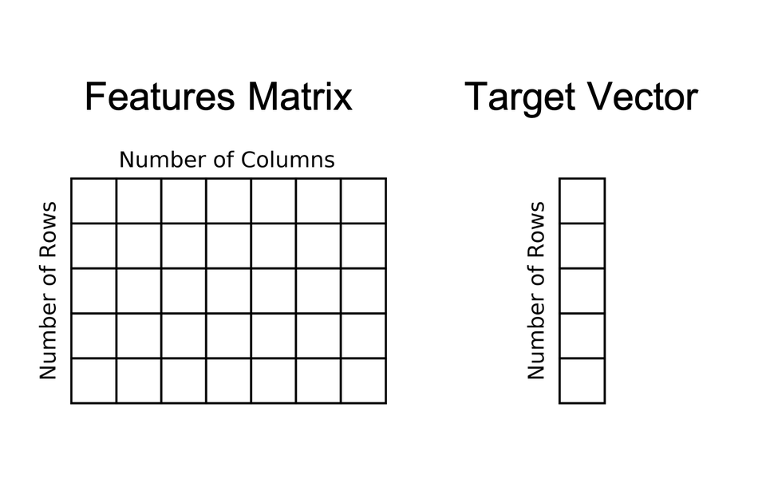</a><br>
      <b>1. <a href="./notebooks/How_to_Format_Data.ipynb">How to format data for scikit-learn</a></b>
      <p>Every scikit-learn model expects a features matrix and a target vector. Getting this right first avoids most beginner errors.</p>
    </td>
    <td width="50%" valign="top">
      <a href="./notebooks/Linear_Regression.ipynb">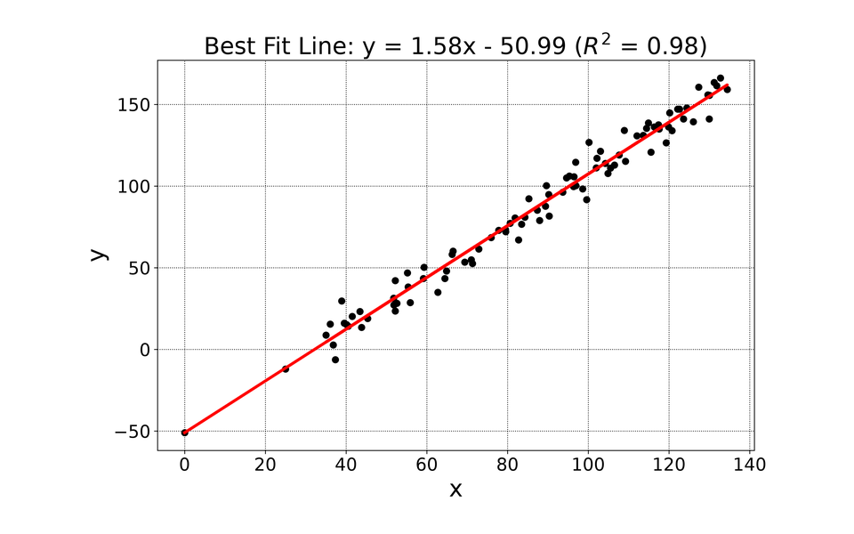</a><br>
      <b>2. <a href="./notebooks/Linear_Regression.ipynb">Linear regression</a></b>
      <p>The simplest model. It introduces the fit-and-predict pattern that every later model uses.</p>
    </td>
  </tr>
  <tr>
    <td width="50%" valign="top">
      <a href="./notebooks/TrainTestSplitScikitLearn.ipynb">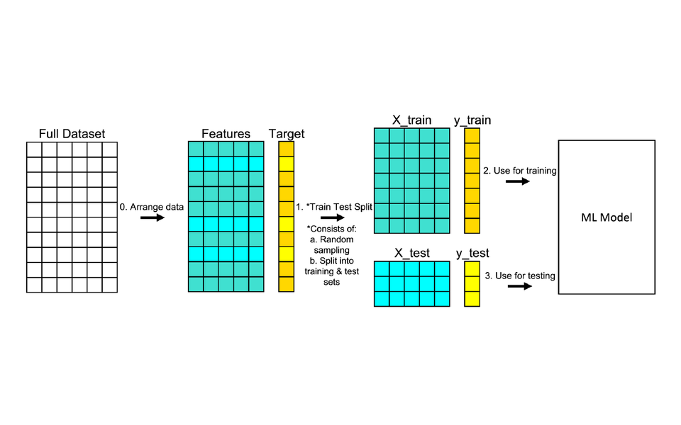</a><br>
      <b>3. <a href="./notebooks/TrainTestSplitScikitLearn.ipynb">Train test split</a></b>
      <p>A model is only useful if it works on data it hasn't seen. This is how you check, and it shows overfitting and the bias-variance tradeoff.</p>
    </td>
    <td width="50%" valign="top">
      <a href="./notebooks/Decision_Trees.ipynb">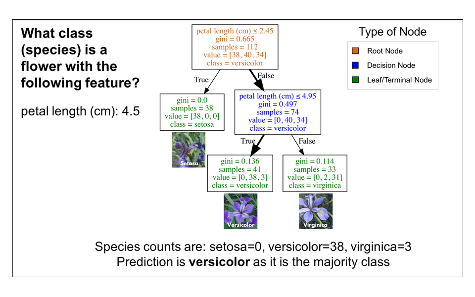</a><br>
      <b>4. <a href="./notebooks/Decision_Trees.ipynb">Decision trees for classification</a></b>
      <p>An interpretable classifier. Tuning <code>max_depth</code> shows how model complexity changes results.</p>
    </td>
  </tr>
  <tr>
    <td width="50%" valign="top">
      <a href="./notebooks/How_to_Visualize_Decision_Trees.ipynb">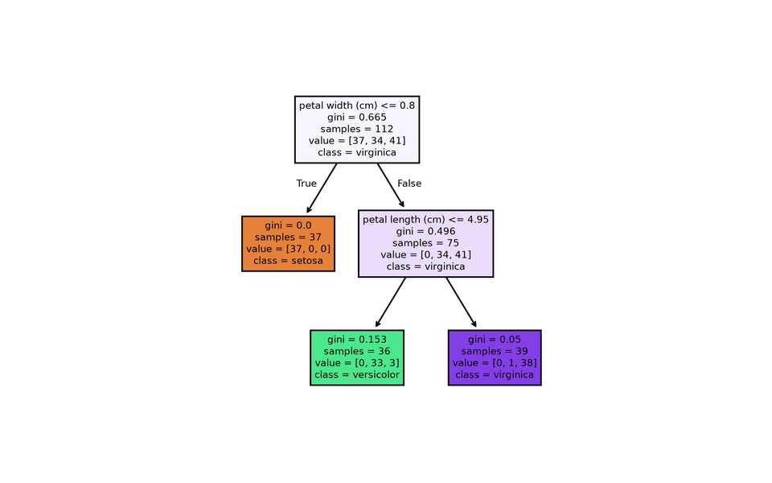</a><br>
      <b>5. <a href="./notebooks/How_to_Visualize_Decision_Trees.ipynb">Visualize decision trees</a></b>
      <p>Seeing the splits lets you check what the model learned and explain it to stakeholders.</p>
    </td>
    <td width="50%" valign="top">
      <a href="./notebooks/RandomForestUsingPython.ipynb">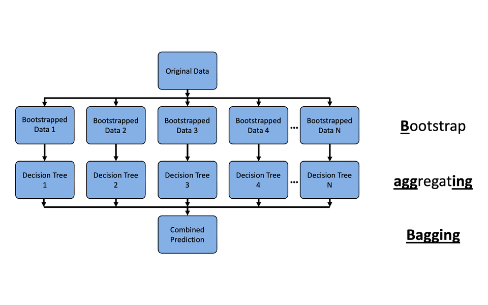</a><br>
      <b>6. <a href="./notebooks/RandomForestUsingPython.ipynb">Random forests</a></b>
      <p>Many trees together usually beat one tree on tabular data. Also covers feature importance and grid search.</p>
    </td>
  </tr>
  <tr>
    <td width="50%" valign="top">
      <a href="./notebooks/Logistic_Regression.ipynb">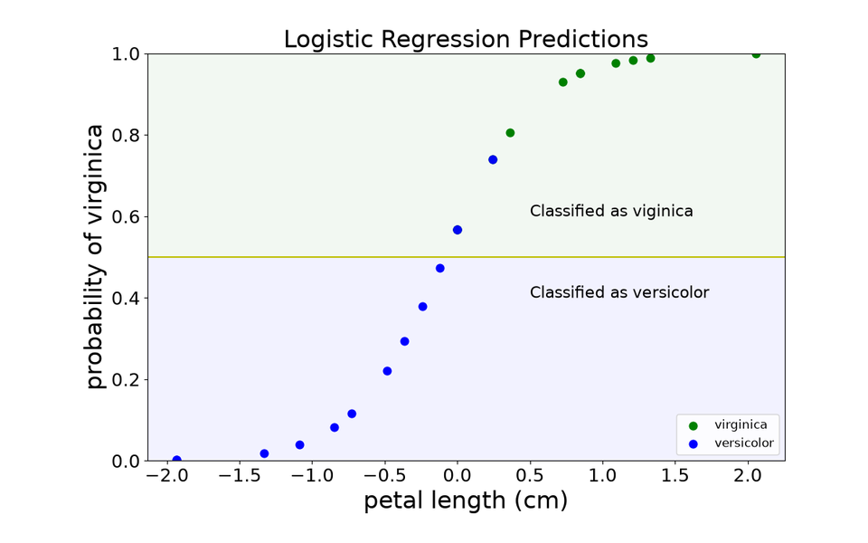</a><br>
      <b>7. <a href="./notebooks/Logistic_Regression.ipynb">Logistic regression</a></b><br><sub><a href="./notebooks/Logistic_Regression_for_Multiclass.ipynb">Multiclass</a> · <a href="https://medium.com/@GalarnykMichael/how-to-speed-up-scikit-learn-model-training-aaf17e2d1e1">Speeding up training</a></sub>
      <p>A classifier that outputs probabilities, which the fraud notebooks later turn into decisions. The multiclass notebook handles more than two classes.</p>
    </td>
    <td width="50%" valign="top">
      <a href="./notebooks/Anomaly_Detection_Evaluation.ipynb">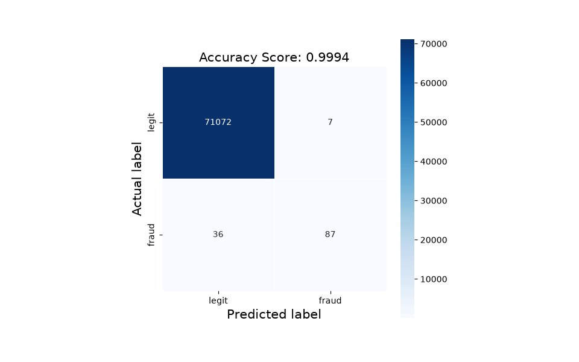</a><br>
      <b>8. <a href="./notebooks/Anomaly_Detection_Evaluation.ipynb">Anomaly detection: evaluating models beyond accuracy</a></b><br><sub>Downloads the <a href="#dataset">dataset</a> on first run</sub>
      <p>Fraud is rare, so a model that never flags anything is 99.8% accurate. Covers leakage, comparing model families, and metrics like PR-AUC that show real differences.</p>
    </td>
  </tr>
  <tr>
    <td width="50%" valign="top">
      <a href="./notebooks/Turning_Scores_into_Decisions.ipynb">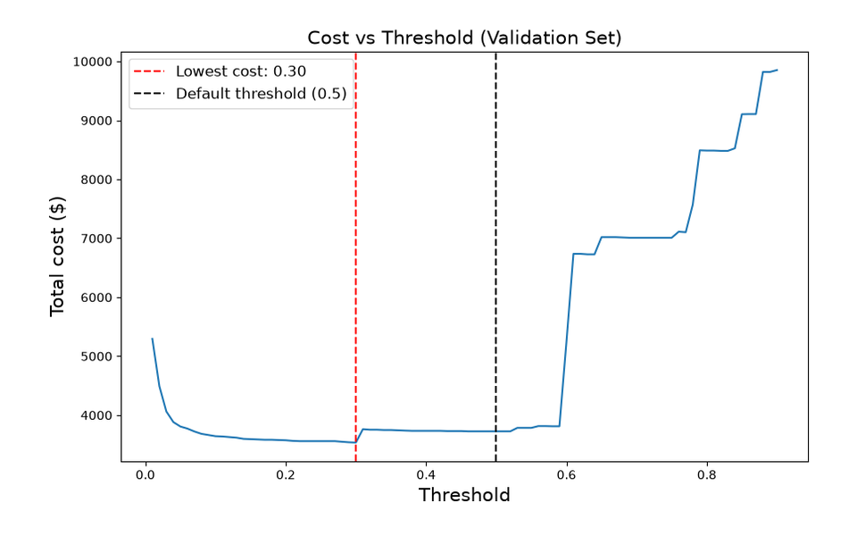</a><br>
      <b>9. <a href="./notebooks/Turning_Scores_into_Decisions.ipynb">Turning model scores into decisions</a></b>
      <p>A model gives a score, but the business needs an action. Covers choosing a threshold from costs, review capacity, and calibration.</p>
    </td>
    <td width="50%" valign="top">
      <a href="./notebooks/Hyperparameter_Tuning.ipynb">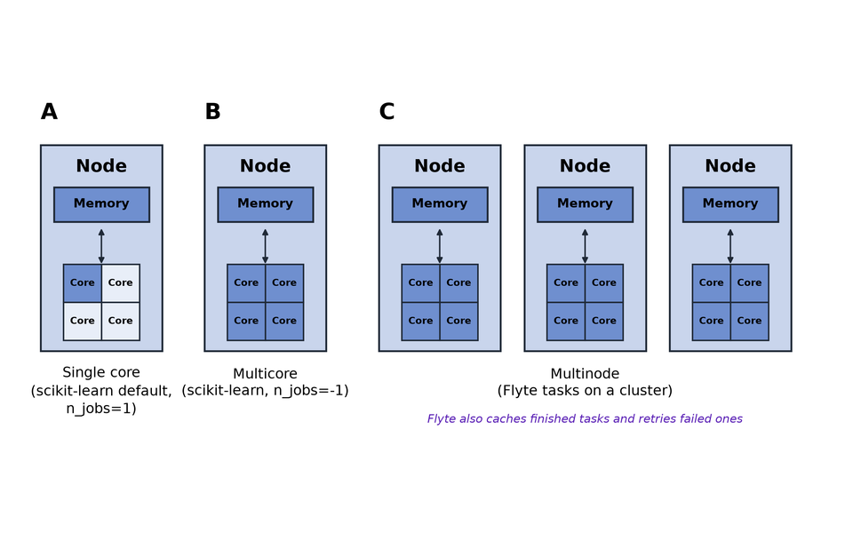</a><br>
      <b>10. <a href="./notebooks/Hyperparameter_Tuning.ipynb">Does additional compute always help? Hyperparameter tuning with more cores and Flyte 2</a></b><br><sub><a href="#optional-run-flyte-on-a-local-cluster">Optional cluster run</a></sub>
      <p>Tuning is where most compute time goes. On the full fraud dataset, a grid search drops from about 30 minutes on one core to under 3 minutes on 16. <a href="https://github.com/flyteorg/flyte">Flyte</a> adds what <code>n_jobs</code> can't: widen the search and only the new candidates run, a failed candidate is retried on its own, and the same code runs on a cluster.</p>
    </td>
  </tr>
  <tr>
    <td width="50%" valign="top">
      <a href="./notebooks/Flyte_Pipeline_with_marimo.py">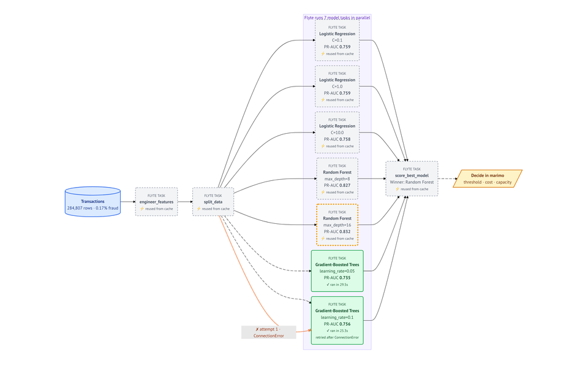</a><br>
      <b>11. <a href="./notebooks/Flyte_Pipeline_with_marimo.py">The fraud detection pipeline with Flyte 2 and marimo</a></b><br><sub><a href="#running-the-marimo-notebook">How to run it</a></sub>
      <p>The whole fraud workflow as <a href="https://github.com/flyteorg/flyte">Flyte</a> tasks. <a href="https://github.com/flyteorg/flyte">Flyte</a> reuses finished tasks from its cache, runs the model comparison in parallel, and retries a task that fails instead of restarting the pipeline.</p>
    </td>
  </tr>
</table>

## Installation

The packages (scikit-learn, Jupyter, [Flyte 2](https://github.com/flyteorg/flyte), [marimo](https://github.com/marimo-team/marimo), and the rest) are listed in `requirements.txt` for uv and in `environment.yml` for conda. Use either option below. Docker is not needed for the notebooks. It is only used for the [optional cluster runs](#optional-run-flyte-on-a-local-cluster) and is installed separately.

First, get a copy of this repo and go into its folder. Every command below runs from this folder:

```
git clone https://github.com/mGalarnyk/MLModelsScikit-Learn.git
cd MLModelsScikit-Learn
```

No git? Click the green **Code** button on GitHub, choose **Download ZIP**, unzip it, and `cd` into the unzipped folder.

### Option 1: uv (recommended)

[uv](https://github.com/astral-sh/uv) is a fast Python package and project manager written in Rust. It installs Python itself and creates the environment for you, so you don't need Python installed first.

1. Install uv:

   ```
   # Mac and Linux
   curl -LsSf https://astral.sh/uv/install.sh | sh

   # Windows (PowerShell)
   powershell -ExecutionPolicy ByPass -c "irm https://astral.sh/uv/install.ps1 | iex"
   ```

   Open a new terminal so the `uv` command is found.

2. From the repo folder, create the environment and install the packages. uv downloads Python 3.11 if you don't have it.

   ```
   uv venv --python 3.11
   uv pip install -r requirements.txt
   ```

3. Get into the environment and start JupyterLab:

   ```
   # Mac and Linux
   source .venv/bin/activate

   # Windows
   .venv\Scripts\activate

   jupyter lab
   ```

   Every time you open a new terminal, go to the repo folder and activate again before running `jupyter lab` or `marimo`:

   ```
   # Mac and Linux
   cd path/to/MLModelsScikit-Learn
   source .venv/bin/activate

   # Windows
   cd path\to\MLModelsScikit-Learn
   .venv\Scripts\activate
   ```

   Replace `path/to` with wherever you cloned the repo (for example `cd ~/Desktop/MLModelsScikit-Learn`). Your prompt starts with `(.venv)` when the environment is active. Leave it with `deactivate`.

### Option 2: conda

1. Install conda if `conda --version` gives "command not found". [Miniforge](https://github.com/conda-forge/miniforge) is a small conda installer (on Windows, download the installer from that page instead):

   ```
   # Mac (Apple Silicon)
   curl -L -O https://github.com/conda-forge/miniforge/releases/latest/download/Miniforge3-MacOSX-arm64.sh
   bash Miniforge3-MacOSX-arm64.sh -b
   ~/miniforge3/bin/conda init zsh
   ```

   Open a new terminal so the `conda` command is found. Anaconda also works if you already have it.

2. From the repo folder, create the environment:

   ```
   conda env create -f environment.yml
   ```

3. Get into the environment and start JupyterLab:

   ```
   conda activate sklearn-workshop
   jupyter lab
   ```

   Every time you open a new terminal, go to the repo folder and activate again:

   ```
   cd path/to/MLModelsScikit-Learn
   conda activate sklearn-workshop
   ```

   Your prompt starts with `(sklearn-workshop)` when the environment is active. Leave it with `conda deactivate`.

### Option 3: Google Colab (nothing to install)

If you can't install software on your computer, open a notebook in [Google Colab](https://colab.research.google.com/) from GitHub (File > Open notebook > GitHub, then paste this repo's URL). scikit-learn, pandas, and matplotlib are already installed. Run this in the first cell so the notebook can find its data files and the [Flyte](https://github.com/flyteorg/flyte) packages:

```
!git clone https://github.com/mGalarnyk/MLModelsScikit-Learn.git
%cd MLModelsScikit-Learn/notebooks
!pip install flyte pyarrow
```

The [marimo](https://github.com/marimo-team/marimo) notebook (`Flyte_Pipeline_with_marimo.py`) and the optional cluster runs need a local install (Option 1 or 2).


## Running the Notebooks

### Dataset

The fraud detection notebooks use the real [Credit Card Fraud Detection](https://www.kaggle.com/datasets/mlg-ulb/creditcardfraud) dataset (284,807 transactions, 492 frauds). They download it (about 150 MB) to `notebooks/data/creditcard.csv` the first time they run, so the first run needs an internet connection.

### Running the [marimo](https://github.com/marimo-team/marimo) notebook

`Flyte_Pipeline_with_marimo.py` is a [marimo](https://github.com/marimo-team/marimo) notebook, not a Jupyter notebook. Start it from the `notebooks` folder:

```
cd notebooks
marimo edit Flyte_Pipeline_with_marimo.py   # notebook view, with code
marimo run Flyte_Pipeline_with_marimo.py    # app view, code hidden
```

A browser tab opens, and the pipeline runs once with Logistic Regression and Random Forest (about 30 seconds). Then add Gradient-Boosted Trees and click "Run pipeline with Flyte" again. The diagram is drawn from [Flyte](https://github.com/flyteorg/flyte)'s own run records:

* **Gray dashed** tasks were reused from [Flyte](https://github.com/flyteorg/flyte)'s cache, so only the new model tasks run.
* An **orange ✗ arrow** is a failed attempt that [Flyte](https://github.com/flyteorg/flyte) retried. The "Simulate losing a worker" box makes the last model task fail its first attempt, like a cloud machine being reclaimed, so you can watch the retry. The retry itself is real [Flyte](https://github.com/flyteorg/flyte) behavior (`retries=2` on the task).

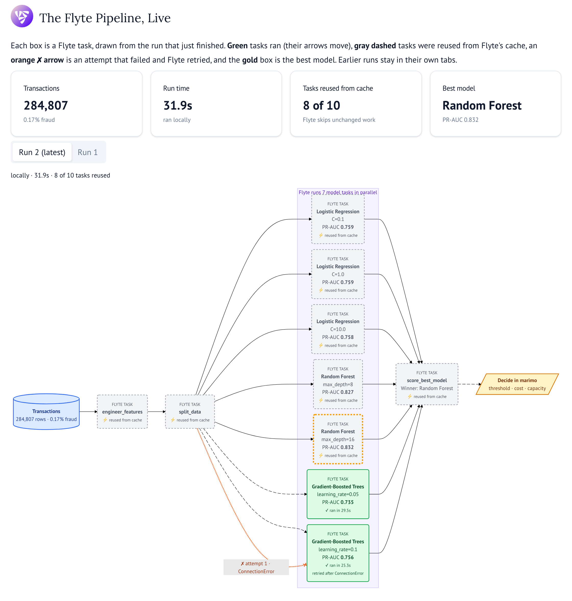

To start fresh, delete the cache with `rm -rf ~/.flyte/local-cache`.

### Optional: Run [Flyte](https://github.com/flyteorg/flyte) on a Local Cluster

[Flyte 2](https://github.com/flyteorg/flyte) runs locally without Docker, so every notebook works without it. Docker is only needed to run the same code on a local [Flyte](https://github.com/flyteorg/flyte) cluster:

1. Install [Docker Desktop](https://www.docker.com/products/docker-desktop/) and start it. Docker is not in `requirements.txt` or `environment.yml`, so install it separately.
2. Start the cluster: `flyte start devbox --apple-silicon` (drop `--apple-silicon` on other machines). The [Flyte](https://github.com/flyteorg/flyte) UI is at http://localhost:30080/v2.
3. In the `notebooks` folder, run `flyte create config --devbox`, then set `RUN_ON_CLUSTER = True` in `Hyperparameter_Tuning.ipynb` or pick "Flyte devbox" in the [marimo](https://github.com/marimo-team/marimo) notebook.
4. Stop the cluster afterwards with `flyte stop devbox`.

## Relevant Links

These resources were shared during audience Q&A.

### Machine Learning
- [Understanding Sampling With and Without Replacement (Python)](https://towardsdatascience.com/understanding-sampling-with-and-without-replacement-python-7aff8f47ebe4/)  
  Explains random sampling principles using clear Python examples.
- [Understanding Random Forest using Python (scikit-learn)](https://youtu.be/R9tJeEgHyeo?si=xKVoLu5eb7v2CgcY)  
  Video walkthrough of how ensemble tree models combine multiple learners.
- [Understanding Decision Trees for Classification (Python)](https://medium.com/data-science/understanding-decision-trees-for-classification-python-9663d683c952)  
  Step-by-step explanation of decision tree construction, splitting, and interpretation.

### Curriculum Learning
- [On the Creation of Narrow AI: Hierarchy and Nonlocality of Neural Network Skills](https://arxiv.org/pdf/2505.15811)  
  Discusses how neural networks develop hierarchical skills and how this relates to curriculum learning and skill transfer.

### Model Deployment and Maintenance
- [Considerations for Deploying Machine Learning Models in Production](https://medium.com/data-science/considerations-for-deploying-machine-learning-models-in-production-89d38d96cc23)  
  Covers practical issues like reproducibility, model retraining, and monitoring.
- [What is Data Drift in ML, and How to Detect and Handle It](https://medium.com/data-science/considerations-for-deploying-machine-learning-models-in-production-89d38d96cc23)  
  Explains how changing data distributions can degrade model performance and what to do about it.

### Reinforcement Learning
- [An Introduction to Reinforcement Learning with OpenAI Gym, RLlib, and Google Colab](https://www.anyscale.com/blog/an-introduction-to-reinforcement-learning-with-openai-gym-rllib-and-google)  
  Practical overview of RL concepts and tools with runnable examples.
- [REFT: Reasoning with REinforced Fine-Tuning](https://arxiv.org/pdf/2401.08967)  
  Paper exploring reinforcement learning methods for reasoning and model fine-tuning.

